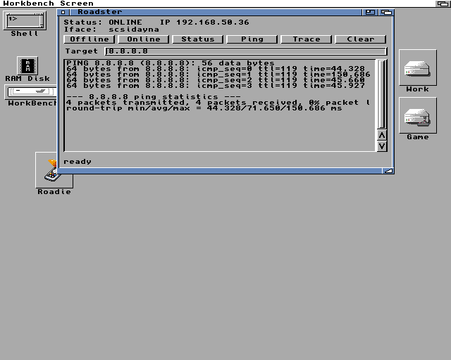

# Roadster

A native AmigaOS Commodity that switches a Roadshow TCP/IP interface on and
off, with a live status readout and Ping / TraceRoute built in.

It fills the same role as Graham Thomson's
[Roadie](http://aminet.net/package/comm/net/Roadie), which inspired it.
Roadster is written from scratch in plain C + GadTools and runs on any
68000+ with Kickstart 2.0+ — it started life chasing crashes on one
particular accelerator setup here, and grew into a full replacement.



*(live on the Amiga 500 it was written for; icon below)*


## What it does

- **Status line** — interface Up/Down and current IP, refreshed every 15 s
  and after every action. Maintains `ENV:RoadshowOnline` (`Online`/`Offline`)
  like Roadie did, for OS 3.2 custom title bars.
- **Offline / Online** — `RemoveNetInterface <iface> FORCE` /
  `AddNetInterface DEVS:NetInterfaces/<iface>`, the pair verified to
  round-trip on hardware. Deliberately *not* `NetShutdown` (a full stack
  teardown blocks on every program holding a socket, and Roadshow then defers
  it to fire asynchronously later — a reliable way to crash a busy machine),
  and not `ConfigureNetInterface ONLINE/OFFLINE` (an interface taken OFFLINE
  could not be revived by ONLINE UP on any machine tested). Remove/Add keeps
  the stack up and re-runs the interface's own config file, like the boot path.
- **Status button** — full `ShowNetStatus` dump into the scrolling list.
- **Ping / Trace** — `ping -c 4` / `traceroute` against the Target host
  (default 8.8.8.8). Commands run **asynchronously**: the GUI never freezes,
  a slow traceroute just ghosts the buttons until it lands.
- **Commodity** — shows in Exchange, hotkey `ctrl alt r` toggles the window,
  the close gadget hides it (Exchange *Remove* or Ctrl-C quits).

## ARexx port `ROADSTER` (v1.1)

Commands: `ONLINE`, `OFFLINE`, `SHOW`, `HIDE`, `STATUS` (returns the status
line as the result string), `QUIT`. rc 5 = busy with another command,
rc 10 = unknown command. Needs RexxMast running.

```rexx
/* example */
address ROADSTER
options results
STATUS
say result      /* e.g. "Status: ONLINE   IP 192.168.1.36" */
```

## Efficiency

Built `-Os`, ~12 KB binary, no dynamic allocation in normal operation (the
listview is a fixed ring pool). The heartbeat timer only runs while a command
is in flight or the window is open - a hidden idle commodity sleeps completely.

## Interface selection

The interface name is auto-detected as the first file in
`DEVS:NetInterfaces/`. Override with `IFACE=<name>` — as a CLI argument or
an icon tooltype. Works with any Roadshow interface type (Ethernet, SLIP…).

## Building

`./build.sh` under WSL with the amiga-gcc (bebbo) toolchain on PATH.
Strip at link time (`gcc -s`); the standalone `m68k-amigaos-strip` corrupts
hunk relocs on this toolchain.

## Files

- `src/roadster.c` — the whole program
- `build.sh` — WSL build script
- `Roadster-1.1.lha` / `Roadster.readme` — the release archive (built with LhA
  on a real Amiga) and its Aminet-style readme
- `docs/` — screenshots; the GlowIcon ships inside the archive
